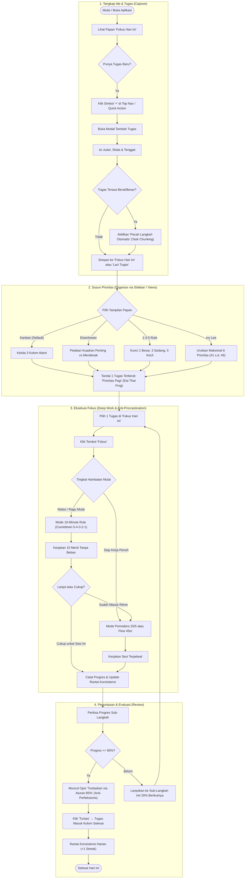

# Product Requirement Document (PRD) — Jadwal-In! Mobile Companion
**Versi**: 2.0 (Professional Productivity & Human-Centered Overhaul)  
**Target Audiens**: Mahasiswa & Profesional Muda (Usia 17–30 tahun)  
**Tujuan Inti**: Alat manajemen tugas harian dan intervensi prokrastinasi akademik berbasis sains perilaku (*behavioral science*), dengan alur kerja minimalis, efisien, dan mandiri (tanpa ketergantungan wajib pada game).

---

## 1. Executive Summary & Problem Statement

### Masalah Utama Pengguna (17–30 Tahun)
1. **Overwhelm & Task Freeze**: Tumpukan tugas kuliah dan pekerjaan yang tidak terstruktur membuat pengguna bingung harus mulai dari mana.
2. **Perfectionist Paralysis**: Menunda pengumpulan tugas karena merasa draf belum 100% sempurna.
3. **Distraksi & Friction Memulai**: Hambatan inisiasi (*initiation barrier*) tinggi pada 10 menit pertama.
4. **Alat yang Terlalu Rumit**: Aplikasi manajemen tugas konvensional sering kali terlalu kaku (SaaS korporat) atau terlalu padat teks dan fitur gamifikasi yang justru mengalihkan fokus kerja.

### Solusi Produk
Aplikasi *task tracker* mobile-first yang bersih, fungsional, dan berbasis komponen profesional (mengadopsi standar desain **shadcn-ui**), menggabungkan framework prioritas yang terbukti secara psikologis:
- **Kanban Board Minimal**: 3 kolom alami (*Laci Tugas*, *Fokus Hari Ini*, *Selesai*).
- **Framework Prioritas Cepat**: Matriks Eisenhower (Penting vs Mendesak), Target 1-3-5, dan Antrean 6 Prioritas Ivy Lee.
- **Micro-Intervention Built-in**: Timer 10-Minute Rule + 5-Sec Countdown, Pomodoro 25/5, Task Chunking dengan 20% Inti Pareto, dan Aturan 85% untuk melawan perfeksionisme.
- **Navigasi Bersih via Sidebar (Shadcn-style)**: Seluruh utilitas sekunder (katalog teknik, jadwal notifikasi, statistik konsistensi, backup data) tersimpan rapi di dalam Sidebar Drawer, menjaga layar utama tetap fokus pada eksekusi tugas.

---

## 2. Peta Alur Pengguna (BPMN Flowchart)

Berikut alur kerja pengguna dari pencatatan tugas, pemilihan prioritas, eksekusi fokus, hingga penuntasan tugas:

---

## 3. Rombakan Arsitektur UI & UX (Berdasarkan Feedback Pengguna)

### A. Sidebar Navigasi Efisien (Shadcn-style Collapsible Sheet/Drawer)
- **Tujuan**: Memindahkan semua menu dan utilitas sekunder agar tidak memadati header atau bagian bawah layar.
- **Struktur Menu Sidebar**:
  1. **Header Sidebar**: Logo minimal + Nama Peserta / Status Sesi.
  2. **Kelompok 1: Tampilan Papan Kerja (Board Views)**:
     - 📋 *Kanban Utama* (Hari Ini, Laci, Selesai)
     - 🎯 *Matriks Eisenhower* (Penting vs Mendesak)
     - 🔢 *Target 1-3-5* (1 Besar, 3 Sedang, 5 Kecil)
     - 🔢 *Antrean Ivy Lee* (6 Prioritas Berurutan)
  3. **Kelompok 2: Ruang Fokus & Alat**:
     - ⏱️ *Timer Fokus & Pomodoro*
     - 📖 *Katalog Teknik Produktivitas* (Ringkasan metode sains perilaku)
     - 📊 *Rantai Konsistensi & Riwayat* (Seinfeld Streak)
  4. **Kelompok 3: Pengaturan & Data**:
     - 🔔 *Pengingat Rutinitas HP* (Habit Stacking & Deadline Notif)
     - 🛡️ *Cadangan & Pemulihan Lokal* (Kode JDW-MOB & JSON)
     - 🎓 *Hubungkan Kode Sesi Pelatihan* (Opsional: impor JI-R1)

### B. Navbar Atas & Floating Command Dock Ultra-Efisien (Thumb-Zone Ergonomics)
- **Top Header Bar Minimalis**:
  - **Sisi Kiri**: Tombol `Menu` (Hamburger icon) untuk membuka Sidebar Drawer.
  - **Tengah**: Judul Papan Aktif & Subtitle status ringkas.
  - **Sisi Kanan**:
    - Status Rantai Konsistensi (`🔥 3 hr`).
    - Tombol `Bell` untuk status notifikasi & pengingat rutinitas.
- **Floating Switcher Dock (Bawah Layar / Area Jempol)**:
  - Mengikuti Hukum Fitts (*Fitts's Law*) untuk kemudahan jangkauan satu tangan di smartphone:
    - **Sisi Kiri**: Tombol Pemilih Tampilan Papan (popover instan: Kanban, Eisenhower, 1-3-5, Ivy Lee).
    - **Tengah (Dominan)**: Tombol `+` (Plus icon kontras tinggi terracota `#D4532F`) untuk tambah tugas instan tanpa teks berulang.
    - **Sisi Kanan**: Tombol Cepat Timer Fokus (`Timer` icon).

### C. Komponen Tambahan Berstandar Shadcn-UI (`D:\repositories\ui`)
Mengadopsi pola komponen modular dari repository `ui`:
- `Sidebar` / `Sheet`: Panel samping drawer mulus dengan animasi geser halus (`framer-motion` / CSS transition).
- `Button` & `ButtonGroup`: Varian `default`, `outline`, `ghost`, `icon` dengan ukuran `size="icon"` dan `size="sm"`.
- `Badge`: Label status tugas dan skala yang minimalis tanpa borders tebal yang norak.
- `Card`: Struktur kartu tugas yang bersih dengan padding modular (8px / 12px / 16px).
- `Dialog` & `Drawer`: Modal tambah tugas dan timer yang terasa native di mobile dan dialog di desktop.

### D. Copywriting Profesional & Non-Gamified (Usia 17–30 Tahun)
- **Sebelumnya**: Menggunakan istilah gamifikasi seperti "Babak Pagi", "Laci Tugas & Lembar Akademik", "Kumpul Nekat 85%".
- **Revisi Profesional**:
  - *"Sesi Pagi"* atau tag waktu *"Pagi"* (bukan Babak Pagi).
  - *"Laci Tugas"* / *"Rencana"* dan *"Fokus Hari Ini"* (bukan formula game).
  - *"Selesaikan di 85% (Anti-Perfeksionis)"*: Menekankan nilai psikologis mengatasi overthinking, bukan sekadar kode mekanik.
  - Deskripsi sub-langkah ditulis dalam aksi nyata (*"Buka draf & buat kerangka"*, bukan teks tutorial game panjang).

---

## 4. Matriks Kebutuhan Fungsional Esensial

| ID | Fitur | Kategori | Prioritas | Manfaat Pengguna |
| :--- | :--- | :--- | :---: | :--- |
| **FR-01** | **Collapsible Sidebar Nav** | Navigasi | P0 | Menyimpan 4 view papan & semua utilitas tanpa memenuhi layar utama. |
| **FR-02** | **Icon-Only '+' Quick Command** | Aksi Cepat | P0 | Menambah tugas dalam 1 ketukan tanpa memakan area horizontal header. |
| **FR-03** | **Kanban 3-Kolom Sederhana** | Papan Kerja | P0 | Membedakan rencana, pekerjaan aktif hari ini, dan tugas selesai. |
| **FR-04** | **Task Chunking & Pareto 20%** | Anti-Prokrastinasi | P0 | Memecah tugas berat jadi 3–5 sub-langkah konkret dengan penanda inti. |
| **FR-05** | **The 85% Finish Trigger** | Anti-Perfeksionisme | P0 | Tombol instan menyelesaikan tugas saat progres $\ge 85\%$. |
| **FR-06** | **Timer Fokus Terpadu (10m & Pomodoro)** | Eksekusi | P0 | Memulai dengan 10 menit pancingan atau siklus 25 menit fokus. |
| **FR-07** | **Offline Local-First & 3-Layer Recovery** | Data & Privasi | P0 | Tanpa server cloud; backup instan lewat kode teks atau JSON. |
| **FR-08** | **Pengingat Rutinitas HP (Habit Stacking)** | Notifikasi | P1 | Pengingat waktu belajar pagi/malam dan H-24 jam tenggat tugas. |
